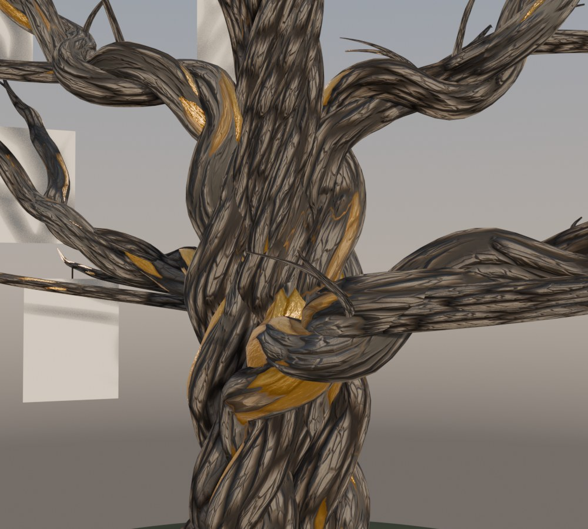
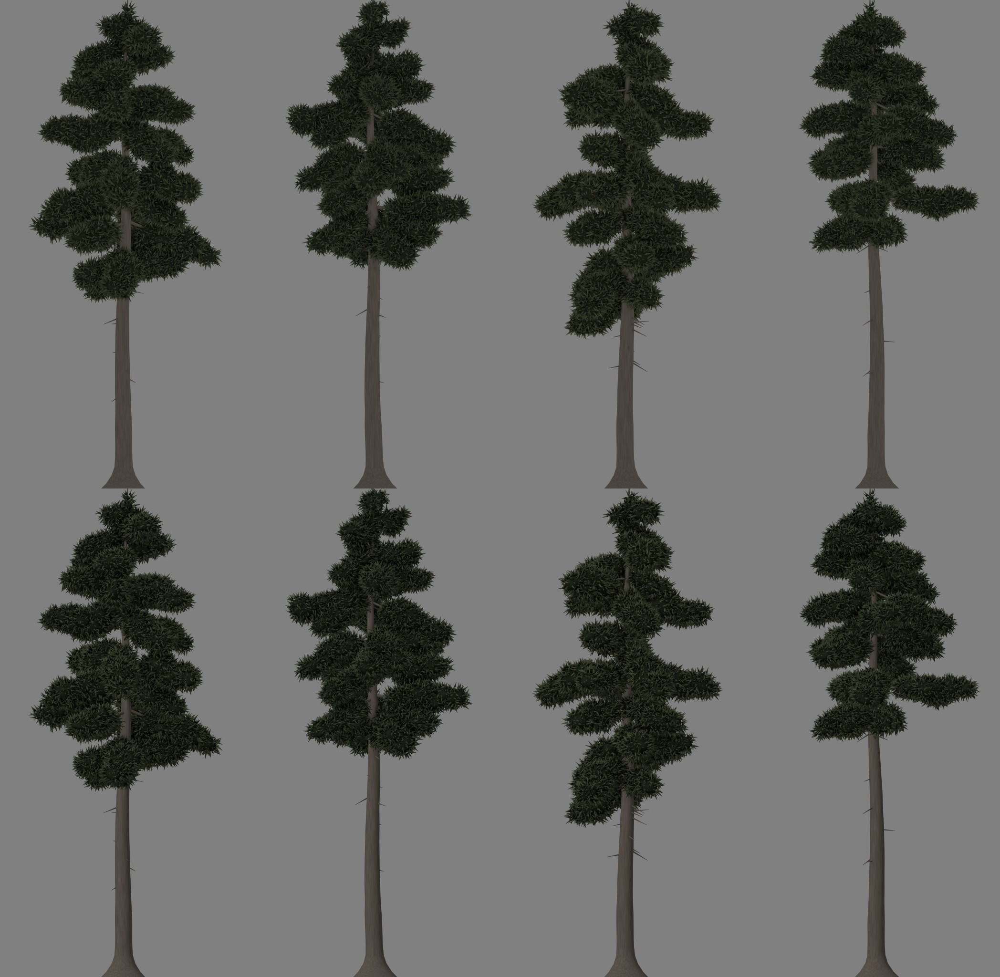

# Blender look-dev of the tiered tree

The tiered tree (`ui/app/TwinedTree.tsx`) gets its form, bark and light designed in Blender first.
This folder holds that setup, so the look can be changed where it is quick to judge and then carried over.




## What is here

| File | What it is |
| --- | --- |
| `tree.py` | Builds the tree in Blender from `family.json`: trunk, limbs, twigs, free branches, bark material, light, a growth animation, and the bake of the bark and gold textures. |
| `family.json` | The example family (17 people, 4 generations) as a tree of couples and children, with a family id that seeds the free branches. |
| `tiers-front.jpg`, `tiers-detail.jpg` | Reference renders of the current look. |
| `forest.py` | Builds the four conifers of the clearing's forest ring and bakes them into the billboard atlas. |
| `forest-preview.jpg` | The four ring trees on grey: the atlas colour as baked (top) and lit through the normal map (bottom). |
| `*.blend` | Not committed. The scene is rebuilt from `tree.py` in a few seconds. |

## What the app takes from it

| In Blender | In the app |
| --- | --- |
| The form rule (`build("E")`) | `ui/app/twinedForm.ts`, written again in TypeScript. This file is what the app runs; `tree.py` is where a change is tried first. The base trunk of eight roots, the higher tiers, the fans at the tips, the root collar, the roots and the warm bark tint exist only in the app so far, so Blender renders look darker than the app. |
| The bark (`bark_graph`) and the gold heartwood (`gold_graph`), baked by `bake()` | `ui/app/bark/bark-color.jpg`, `bark-normal.jpg`, `bark-data.jpg`, `gold-color.jpg`, `gold-data.jpg`, loaded by `ui/app/TwinedTree.tsx`. |
| The ring trees (`forest.py`), baked by its `bake()` | `ui/app/forest/ring-color.png`, `ring-normal.png`, `ring.json`, loaded by `ui/app/ForestRing.tsx`. |
| Light, sky, hill | Nothing. The app has its own scene (`ui/app/Scene.tsx`); the Blender light only imitates it. |

The textures tile in metres: one texture is one tile of `TILE_ALONG` (4 m) along the wood and `TILE_AROUND` (1 m) around it, the same constants as in `ui/app/twinedForm.ts`, and every tube gets a whole number of tiles around.
`bark-data.jpg` and `gold-data.jpg` carry ambient occlusion in red, roughness in green and height in blue, so three.js reads them as `aoMap` and `roughnessMap` and the shader (`ui/app/barkShader.ts`) reads the height.
The bark is pure bark; the gold only shows in the app's scars and veins.

## How to use it

1. Open Blender (5.x), a new file, and save it into this folder.
2. In the Scripting tab run:
   ```python
   HERE = "/path/to/ftree/docs/design/blender"
   exec(open(HERE + "/tree.py").read())
   setup(); build("E"); grow("E"); show("E")
   ```
3. Change parameters in `tree.py` (`BASE`, `VARIANTS["E"]`, `bark_graph`), run again, look.
   `shot(path)` renders a still, `check("E")` reports kinks and wood that comes too close to a card.
4. When the bark or the gold changed, run `bake(HERE + "/../../../ui/app/bark")` and commit the five images. It also runs without the Blender window: `Blender -b --factory-startup --python <script>`, where the script sets `HERE`, runs `tree.py` and calls `bake(...)`.
5. When the form changed, carry the change over to `ui/app/twinedForm.ts` and run `node app/twinedForm.check.mjs` in `ui/`.

## Forest ring billboards



The clearing around the tiered tree (`docs/superpowers/specs/2026-11-17-clearing-design.md`) is ringed by a deep forest of camera-facing billboards (`ui/app/ForestRing.tsx`).
They are four conifers built by `forest.py` and baked into one atlas (2026-11-17); before that, the app drew three placeholder silhouettes in code.
The camera never leaves the clearing, so every ring tree is seen from inside it, within about ±50° of its inward direction, and one view per tree is enough.

What is modelled (chosen 2026-11-17, image A in `docs/design/visions/`; form and colour of the four trees approved by the user 2026-11-17):

- Tall slim conifers: a bare, straight trunk up to 40 to 50 % of the height, then a narrow crown of irregular tufts that tapers to the tip.
- Crown width about 0.35 to 0.5 of the tree's height; four trees that differ in crown start, width and how ragged the tufts are.
- Model at about 30 m; the app scales each tree to 70 % of the tiered tree's top, ±15 %.
- Dark olive crowns and grey-brown trunks, not saturated: the app's blue-grey haze and the sun do the rest.

What the bake writes and the app expects:

| File | Content |
| --- | --- |
| `ui/app/forest/ring-color.png` | Atlas of 4096 × 2048 px: the four trees side by side, each in a 1024 × 2048 cell, foot on the bottom edge, the tree's top on the top edge, trunk axis on the cell's vertical centre line. sRGB colour with straight alpha, no baked light, ambient occlusion multiplied in, the colour dilated 4 px past the alpha edge so mipmaps do not darken the outline. |
| `ui/app/forest/ring-normal.png` | Tangent-space normals in the same layout, OpenGL convention (+Y up), like `bark-normal.jpg`; RGB without alpha. |
| `ui/app/forest/ring.json` | Per tree its modelled height in metres and the trunk's foot in the cell, in pixels from the cell's top left, for example `{ "trees": [{ "height": 30, "foot": [512, 2040] }, …] }`. Because the tree's top lies on the cell's top edge, a tree has `foot[1] / height` pixels per metre. |

How it renders: one orthographic camera per tree looking horizontally at it along +Y, framing exactly its cell; transparent film; Cycles with every material an emission of colour times ambient occlusion (no lights), switched to the shading normal in the camera's frame for the second pass.
The passes are saved as float EXR, un-premultiplied, the colour dilated and encoded to sRGB, and the normals flipped toward the camera where thin geometry shows its back.

How to use it:

1. In Blender (5.x) or without its window, run:
   ```python
   HERE = "/path/to/ftree/docs/design/blender"
   exec(open(HERE + "/forest.py").read())
   setup(); build_all()                          # the four trees in a scene "Forest", 20 m apart
   preview(HERE + "/forest-preview.jpg")         # quick renders on grey, to judge form and colour
   bake(HERE + "/../../../ui/app/forest")        # the atlas, about 5 minutes on an M1
   ```
   Without the window: `blender -b --factory-startup --python-expr '<the lines above>'`.
   The first Cycles render on a Mac compiles the Metal kernels, which takes a few minutes once.
2. Change a tree in `TREES` (height, crown start, width, raggedness, lean, tint, seed) or the colours at the top of `forest.py`, preview, and bake only after the look is approved.
3. Commit the three files in `ui/app/forest/`; the app picks up the number of cells and the heights from `ring.json`.

`ForestRing.tsx` scales every tree so that its top reaches the ring's height for it, times its modelled height over the four trees' mean, and sinks its foot 0.3 m into the ground.
The atlas weighs about 10 MB (colour 4.6 MB, normals 5.5 MB) and is only loaded with the Stufenbaum.

## Known differences between Blender and the app

- Card angles: Blender lays the family out itself (`layout()` in `tree.py`), the app uses `ui/app/twinedLayout.ts`. Both keep families together with air between them, but the app centres the family on the front.
- Free branches: Blender draws all chance from one sequence seeded with the family id. The app seeds every free branch with its own name, so it keeps its shape while the family grows, and it has no filler limbs yet.
- Scars and gold veins exist only in the app (`scarsFor` in `twinedForm.ts`, `barkShader.ts`); Blender renders show pure bark.
- Depth: the app sinks the furrows by parallax, Blender uses a bump on the same height.
