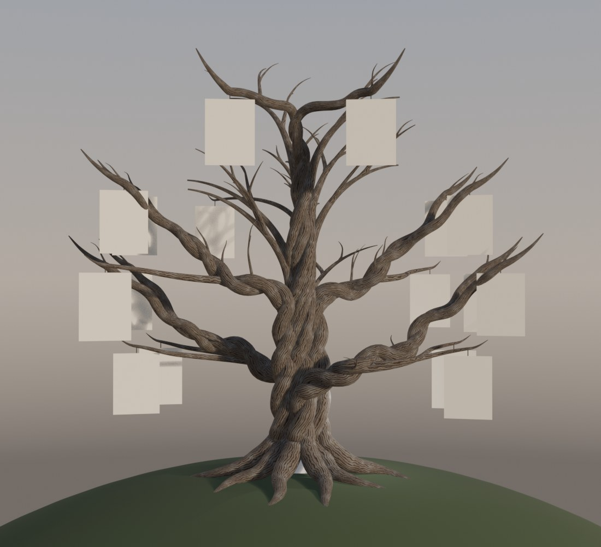

# Blender look-dev of the tiered tree

The tiered tree (`ui/app/TwinedTree.tsx`) gets its form, bark and light designed in Blender first.
This folder holds that setup, so the look can be changed where it is quick to judge and then carried over.




## What is here

| File | What it is |
| --- | --- |
| `tree.py` | Builds the tree in Blender from `family.json`: trunk, limbs, twigs, free branches, bark material, light, a growth animation, and the bake of the bark and gold textures. |
| `family.json` | The example family (17 people, 4 generations) as a tree of couples and children, with a family id that seeds the free branches. |
| `tiers-front.jpg`, `tiers-detail.jpg` | Reference renders of the current look. |
| `*.blend` | Not committed. The scene is rebuilt from `tree.py` in a few seconds. |

## What the app takes from it

| In Blender | In the app |
| --- | --- |
| The form rule (`build("E")`) | `ui/app/twinedForm.ts`, written again in TypeScript. This file is what the app runs; `tree.py` is where a change is tried first. The base trunk of eight roots, the higher tiers, the fans at the tips, the root collar, the roots and the warm bark tint exist only in the app so far, so Blender renders look darker than the app. |
| The bark (`bark_graph`) and the gold heartwood (`gold_graph`), baked by `bake()` | `ui/app/bark/bark-color.jpg`, `bark-normal.jpg`, `bark-data.jpg`, `gold-color.jpg`, `gold-data.jpg`, loaded by `ui/app/TwinedTree.tsx`. |
| Light, sky, hill | Nothing. The app has its own scene (`ui/app/Scene.tsx`); the Blender light only imitates it. |

The textures tile in metres: one texture is one tile of `TILE_ALONG` (4 m) along the wood and `TILE_AROUND` (1 m) around it, the same constants as in `ui/app/twinedForm.ts`, and every tube gets a whole number of tiles around.
`bark-data.jpg` and `gold-data.jpg` carry ambient occlusion in red, roughness in green and height in blue, so three.js reads them as `aoMap` and `roughnessMap` and the shader (`ui/app/barkShader.ts`) reads the height.
The bark is pure bark; the gold only shows in the app's scars and veins.

## How to use it

1. Open Blender (5.x), a new file, and save it into this folder.
2. In the Scripting tab run:
   ```python
   HERE = "/path/to/ftree/docs/design/blender"
   exec(open(HERE + "/tree.py").read())
   setup(); build("E"); grow("E"); show("E")
   ```
3. Change parameters in `tree.py` (`BASE`, `VARIANTS["E"]`, `bark_graph`), run again, look.
   `shot(path)` renders a still, `check("E")` reports kinks and wood that comes too close to a card.
4. When the bark or the gold changed, run `bake(HERE + "/../../../ui/app/bark")` and commit the five images. It also runs without the Blender window: `Blender -b --factory-startup --python <script>`, where the script sets `HERE`, runs `tree.py` and calls `bake(...)`.
5. When the form changed, carry the change over to `ui/app/twinedForm.ts` and run `node app/twinedForm.check.mjs` in `ui/`.

## Known differences between Blender and the app

- Card angles: Blender lays the family out itself (`layout()` in `tree.py`), the app uses `ui/app/twinedLayout.ts`. Both keep families together with air between them, but the app centres the family on the front.
- Free branches: Blender draws all chance from one sequence seeded with the family id. The app seeds every free branch with its own name, so it keeps its shape while the family grows, and it has no filler limbs yet.
- Scars and gold veins exist only in the app (`scarsFor` in `twinedForm.ts`, `barkShader.ts`); Blender renders show pure bark.
- Depth: the app sinks the furrows by parallax, Blender uses a bump on the same height.
