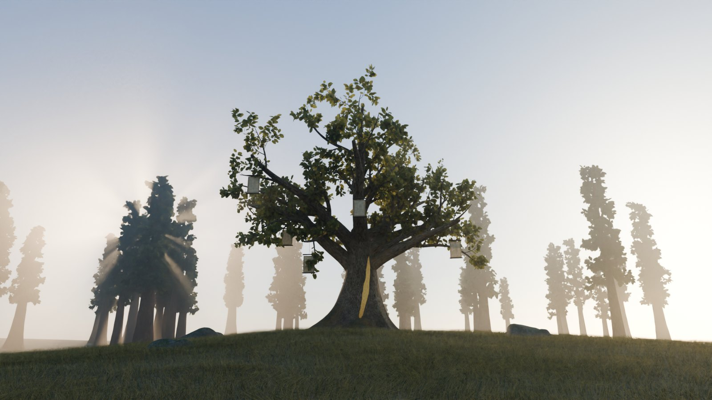
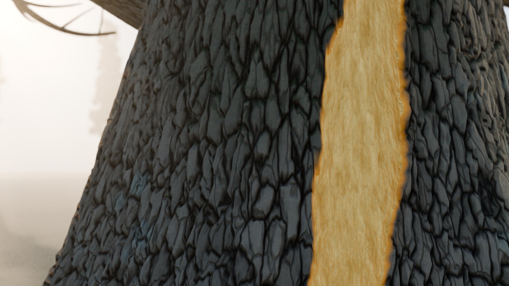
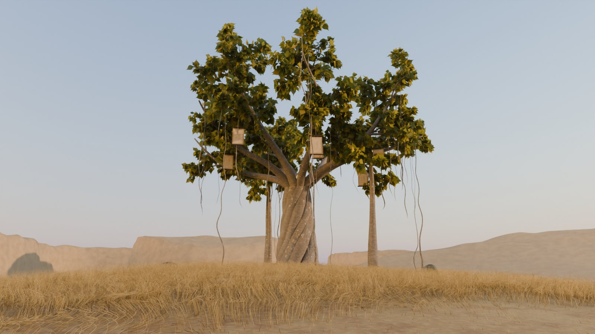
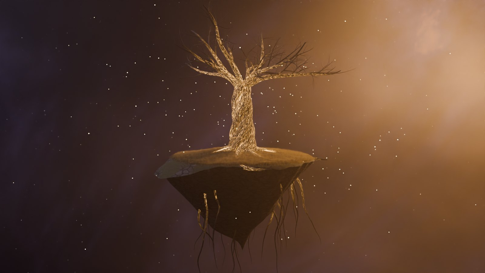
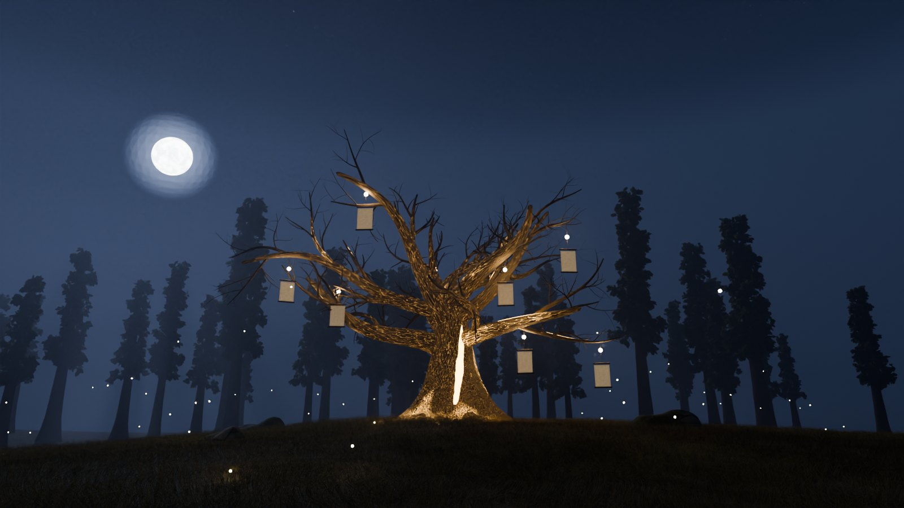

# Tree visions ("Baumvisionen", 2026-11-16)

Concept renders of where the tiered tree ("Stufenbaum") can go: natural, yet epic.
Rendered in Blender 5.3 with Cycles (1600 × 900, 40 samples, denoised); tree, bark, grass, forest, island and sky were built procedurally by a Python script, no bought assets, no AI images.
That script was not kept; only the tree's own look-dev script lives in [../blender/tree.py](../blender/tree.py).
This page was first published as a private claude.ai artifact and is kept here so every machine and agent has it.

## Direction chosen (2026-11-16)

The user chose **A "Lichtung"** by day and **D "Nachtwache"** by night, the same clearing.
The steps are specced in [2026-11-16-scene-light-and-post-design.md](../../superpowers/specs/2026-11-16-scene-light-and-post-design.md), "The whole direction":

1. Light and image – done, PR #362.
2. Bark v2 – done, PR #365 ([spec](../../superpowers/specs/2026-11-16-bark-v2-design.md)).
3. Clearing – open: hill, ring of forest as billboards, rocks, grass in the wind, light shafts.
4. Night watch – open: the gold's glow follows the sun, a warm light at the trunk, the moon as rim light, dark blue night sky.

Leaves and walking/climbing come after that (see "Suggested order" below).

Deviation since: the gold is no longer "sparing". After seeing bark v2 the user asked for more: veins fill whole furrows in patches, about every third person strand has a scar, and one base strand is bared (bark v2 spec, "Changes while building").

## What the forest reference has and the tree does not yet

- **Light from the side:** a low, side sun gives every form a lit and a dark side; the app lit everything flat from the front.
- **Air:** haze takes contrast away with distance and shows light shafts; the app's distance was as sharp as the foreground, the horizon a hard edge.
- **Scale:** rocks, ferns, young trees and water tell how big trunks are; next to the tree there is nothing, so it reads like a model on a table.
- **Layering:** foreground, middle ground, background; the app has the tree and an endless even green.
- **Ground contact:** roots lift the soil, moss sits in cracks, shadows gather in joints; the roots lie on the lawn without contact shadow.
- **Muted colours:** forest green is olive-grey and turns blue with distance; the grass is saturated artificial-turf green, the sky flat light blue.

## A – The clearing ("Lichtung")



An ancient tree with a massive trunk and buttress roots stands on a flat hill in the middle of a clearing.
A ring of tall conifers fades into haze; the low sun sends shafts between the trunks.
The forest edge is also the natural boundary when people walk around later.

- **Setting:** closed horizon of forest, hill 2–3 m high, clearing about 50 m in radius.
- **Light:** back light from behind left, haze, light shafts.
- **Gold:** scars on the trunk, single deep cracks.
- **Leaves:** a light crown of leaf clusters.
- **Strength:** scale and depth read at once, walkable, close to the forest reference.
- **Risk:** the forest ring costs performance and needs billboards instead of real trees.

## Bark close-up



55 mm, f/2.2, from direction A: furrowed bark with a scar of golden heartwood.

- **Bark in world size:** plates about 7 × 60 cm, the same size everywhere, long furrows, few cross breaks, moss on the upper side.
- **Callus:** around each scar the bark bulges; the rim catches light and glows most.
- **Gold core with grain:** lies below the bark, is real metal with wood fibres and reflects the sky.

Why the old bark looked like a game from around 2000 (all fixed in parts 1 and 2): prismatic strands with 9 sides, bark stretched once around each tube, gold as paint on top, metal without an environment to reflect, no ambient occlusion or height, hard intersections, exposure 0.6 as a brake.

## B – Bodhi (not chosen)



The braided trunk is botanically a fig already; where strands part, a golden core would shimmer.
Dry savanna, mesas, golden hour, aerial roots, heart-shaped leaves.
Fits the trunk and is calm, but less magical, and aerial roots compete with the scrolls for space.

## C – Xibalba (not chosen as the everyday scene)



The tree on a floating island in a golden nebula, roots hanging into the void, sparks around the crown, light breaking from inside.
Maximally epic and recognisable as a brand, but no ground to walk on and an abstract scale.
Kept as an idea for the landing page, a transition when zooming in, and an overview of several families (each family an island in the same sky).

## D – Night watch ("Nachtwache")



The same clearing at night, the tree without leaves.
It glows from its gold scars, just enough to show its form; the light orbs that already exist float above the scrolls, fireflies in the grass, the moon sets a cool edge from behind.

- **Setting:** as A, starry sky, moon.
- **Light:** moon as rim light, the tree as warm source.
- **Gold:** glows, coupled to the sun's altitude.
- **Leaves:** bare, as the tree is today.
- **Risk:** needs bloom and good dark values, or it turns grey instead of nocturnal.

## Answers to the open questions

### Globe or horizon?

Horizon with a clearing for every day, the island for special moments.
Walking and climbing need ground, gravity and a boundary; a forest edge is an invisible wall nobody notices.
On a small planet the camera has to move far away and the tree becomes a toy.
A hill instead of a mountain: 2–3 m high in a clearing of about 50 m radius; a mountain would make the tree smaller.

### Leaves on the branches or own leaf twigs?

Own leaf twigs, as cards hung on the last two branch levels.
Build 4–8 small twigs with 15–40 leaves each in Blender and bake them into an atlas (colour, normals, alpha, translucency).
Below about 3 cm branch thickness there is no geometry any more, only these cards as an `InstancedMesh` (as SpeedTree does: few draw calls, natural density, wind per card).
Seasons are another atlas; autumn leaves in gold tie the crown to the gold in the trunk.

### Glow, but not always the same

Couple the glow to the sun's altitude; by day the gold is only metal and reflects sky and sun.
From sunset the scars' glow rises until the end of civil twilight and breathes slowly at night:

```text
sun = sun altitude in degrees
glow = smoothstep(0, -6, sun)            // 0 by day, 1 after twilight
glow *= 1 + 0.12 * sin(t * 2π / 7s)    // slow breathing
emission = gold * glow * 4
bloom only over emission (threshold)
```

Add a faint warm light at the trunk that lights the ground around the tree, and the moon as a cool rim light from behind.

## From render to browser

The renders are path traced; the browser lacks real indirect light and volumetrics, but these get close (effect / effort, 1–3):

| Measure | Acts on | Effect | Effort | State |
|---|---|---|---|---|
| Environment from the sky (`PMREMGenerator` → `scene.environment`) | gold reflects, bark takes sky colour | 3 | 1 | done (part 1) |
| AgX tone mapping instead of the exposure trick | contrast, colours | 2 | 1 | part 1 kept ACES, see its spec |
| Post-processing: ambient occlusion, bloom for gold, vignette, grading | ground contact, glow | 3 | 2 | done (part 1) |
| Height fog and aerial perspective | depth, scale | 2 | 1 | done (part 1) |
| 24–32 sides for thick strands | silhouette | 2 | 1 | done (part 2); radius noise, bulges, LOD open |
| Bark v2: metres tiling, AO and height, parallax for sunk gold | close-up | 3 | 2 | done (part 2) |
| Grass as instanced blades with wind in the vertex shader | life | 2 | 2 | part 3 |
| Forest ring as billboards rendered in Blender | setting | 2 | 2 | part 3, needs Blender |
| Screen-space light shafts (god rays) | mood | 2 | 2 | part 3 |
| Leaves as twig cards with wind and translucency | crown | 3 | 3 | after part 4, needs Blender |
| Trunk as hero mesh: strands merged in Blender, high poly baked to normal and AO maps, glTF with KTX2 | fused growth | 3 | 3 | later |

## Suggested order

1. **Light and image** – environment, tone mapping, ambient occlusion, bloom, fog.
2. **Bark v2** – baked again in Blender in world size, AO and height, sunk gold, callus rim, more sides.
3. **Setting** – clearing, forest ring, rocks, grass in the wind.
4. **Evening glow** – glow coupled to the sun's altitude, light at the trunk, moon as rim.
5. **Leaves** – twig cards from Blender, one season first.
6. **Later: walking and climbing** – trunk as one merged mesh, collision from the branch skeleton (a capsule per branch), wide branches as walkable paths.
